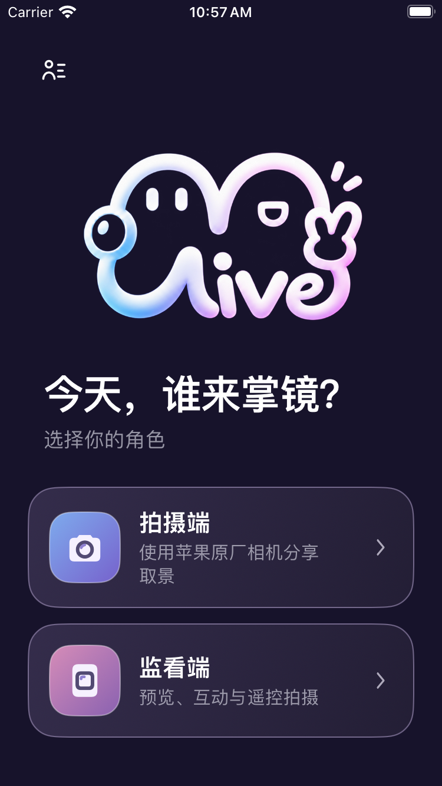
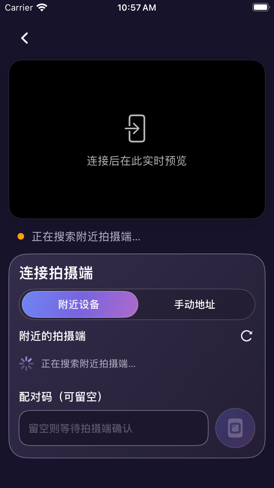

# MGLive iOS 测试版

当前测试版本为 **0.3.79（83）**，需要 iOS 16 或更高版本。

iOS 版本目前仍通过开发签名测试，尚未提供公开 App Store 或 TestFlight 下载。普通 APK 不能安装在 iPhone 上，也没有无需授权即可安装的公开 IPA。

已参加开发测试的设备，请继续使用开发者提供的授权安装方式覆盖更新，保留原有数据。签名过期时需要重新签名安装。

点击首页用户管理图标右侧的版本号，在小气泡里查看更新结果和新版说明。开放 App Store 或 TestFlight 后，这里也会提供对应的更新入口。

在“用户管理”中，点击“当前权益”旁的提示图标，可展开购买与退款说明、售后联系方式和 Apple 退款入口。

功能、权限与隐私说明见项目首页。反馈邮箱：**miguawu@yeah.net**。

## 界面预览

以下为 iOS 0.3.77 的模拟器截图。监看端处于等待连接状态，预览区域没有真实拍摄画面；截图不代表已经在 App Store 上架。

| 首页：选择角色 | 监看端：等待连接 |
| --- | --- |
|  |  |
