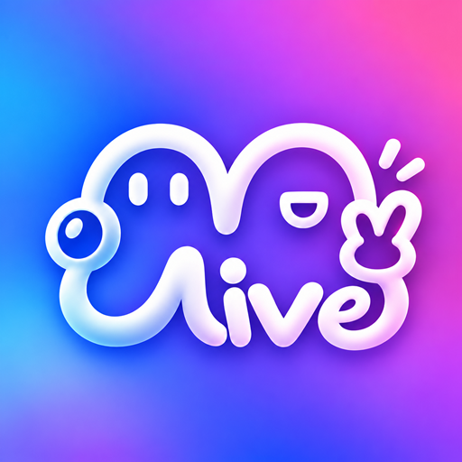

  

# MGLive · 拍摄与实时监看

让另一台手机成为你的取景监看屏。MGLive 在同一 Wi-Fi 或手机热点中连接两台设备：**拍摄端继续使用相机拍摄，监看端实时查看画面、语音沟通，并在支持的设备上遥控快门。**

适合双人拍摄、合影取景、固定机位构图和拍摄现场协作。拍摄画面与语音在局域网设备之间传输；它不提供跨互联网远程监控或云端录像。

本仓库提供安装包、版本记录和使用说明。当前 Android 公测版：**0.3.87（94）**。本文以该版本为准，旧版本的入口和功能可能不同。

**快速入口：** [下载安装](#下载安装) · [五分钟开始使用](#五分钟开始使用) · [账号与使用权益](#账号与使用权益android) · [权限说明](#权限说明) · [隐私说明](PRIVACY.md) · [常见问题](#常见问题) · [反馈与售后](#反馈与售后)

## 可以做什么

| 功能 | 使用方式与边界 |
| --- | --- |
| 实时监看 | 在另一台设备查看拍摄端正在分享的画面；延迟和清晰度受网络、设备及系统限制影响。 |
| 保留相机拍摄体验 | 拍摄仍由拍摄端的相机 App 完成，照片与视频由相机保存；MGLive 不代替相机拍照或保存原片。 |
| 发现与连接 | 自动发现同一局域网内的拍摄端，也可手动输入连接地址。 |
| 配对确认 | 输入当前有效的 6 位配对码，或留空后由拍摄端确认本次连接。 |
| 语音沟通 | 按需打开麦克风进行对讲；可随时关闭。相机录像占用麦克风时可能限制对讲。 |
| 遥控快门 | 已连接的监看端可请求 Android 拍摄端触发快门，需相机兼容及相应辅助权限。 |
| 轻量互动 | 发送应用内提供的互动表情；拍摄端显示能力因平台而异。 |
| 角色切换 | 同一台设备可以选择拍摄端或监看端；切换角色时先结束当前分享或连接。 |

## 下载安装

| 安装包 | 适用设备 |
| --- | --- |
| [Android 通用版 APK](https://github.com/lukamorefree/mglive-downloads/releases/latest/download/MGLive-Android.apk) | Android 8.0 及以上的 ARM 32/64 位手机和平板；不确定架构时选此版本。 |
| [Android ARM64 精简版 APK](https://github.com/lukamorefree/mglive-downloads/releases/latest/download/MGLive-Android-arm64.apk) | 支持 64 位 Android 应用的 ARM64 设备；功能相同，下载体积更小。 |
| [全部版本及更新说明](https://github.com/lukamorefree/mglive-downloads/releases) | 查看版本号、更新内容和对应安装包。 |
| [安装包 SHA-256 校验值](https://github.com/lukamorefree/mglive-downloads/releases/latest/download/SHA256SUMS.txt) | 与同一次发布的 APK 对照，确认文件下载完整。 |

1. 下载其中一个 APK，在设备上打开它。
2. 若系统要求，为本次使用的浏览器或文件管理器允许“安装未知应用”。这是安装来源的系统授权，不是 MGLive 的功能权限；安装后可关闭。
3. 按系统提示完成安装。更新时直接覆盖安装官方同签名版本，通常会保留本机数据。
4. 如果提示安装包不兼容，先尝试通用版。若提示签名冲突或无法降级，请先确认安装来源与版本，不要为了解决安装提示直接卸载已有应用。

**iOS 状态：** iOS 16 及以上版本正在开发测试，尚未提供公开 App Store 下载或正式内购。本页 APK 不能安装到 iPhone 或 iPad，也不代表已在应用商店上架。

## 五分钟开始使用

### 1. 准备两台设备和网络

- 两台设备连接到同一个允许设备互访的 Wi-Fi；也可以一台开个人热点，另一台连接该热点。
- 不需要开放路由器公网端口。访客 Wi-Fi、AP 隔离、部分校园或企业网络可能阻止设备互相连接。
- 尽量让两台设备靠近路由器或热点。能稳定覆盖时可选 5 GHz Wi-Fi，减少拥挤网络的干扰。
- 首次启用账号、刷新权益、邮箱验证及购买需要互联网。进入无外网环境前，先联网打开应用并确认“当前权益”可用。

### 2. 设置 Android 拍摄端

1. 打开 MGLive，在首页选择 **“拍摄端”**。
2. 在更多设置中选择要使用的相机 App。
3. 按提示开启 **“MGLive 相机状态与快门（实验）”** 服务。通常位于“系统设置 → 无障碍 → 已下载的应用／已安装的服务”，名称随厂商变化。
4. 点击 **“开始分享”**，阅读并确认系统屏幕共享授权。系统若提供分享范围选择，应选择能包含相机 App 的**整个屏幕**；仅分享 MGLive 窗口无法看到切换后的相机。
5. 点击 **“打开相机”**，让选定的相机保持前台；记录或告知监看者拍摄端显示的配对码。

当前 Android 版本需要相机状态服务来判断选定相机是否处于前台。离开相机或服务不可用时，应用会暂停发送画面。分享结束后仍请主动点击“停止分享”，不要把暂停画面当成已撤销系统屏幕共享授权。

### 3. 连接监看端

1. 另一台设备打开 MGLive，选择 **“监看端”**。
2. 在 **“附近设备”** 中选中拍摄端；未发现时点击刷新，或切换到 **“手动地址”**。
3. 手动连接时填写拍摄端显示的 IP／主机名和端口，不要填邮箱、设备编号或网站地址。
4. 输入拍摄端当前显示的 **6 位配对码**，点击“开始监看”；也可留空并等待拍摄端允许本次请求。
5. 成功连接后，拍摄端打开相机，监看端即可查看画面。

配对码用于本次局域网连接，**不是邮箱登录验证码**。配对码过期或刷新后，应使用新码。不要接受不认识的监看请求。

### 4. 对讲、遥控与结束

- **对讲：** 点击麦克风开关并按需授权。设备距离太近时可用耳机或降低扬声器音量，减少回声。
- **遥控拍摄：** 监看端点击遥控拍摄按钮，由 Android 拍摄端在已选择的相机中执行。相机控件无法识别时，可在拍摄端更多设置中按引导学习一次快门；学习时点击快门也会实际拍摄。相机更新或横竖屏变化后可能需要重新学习。
- **互动：** 点击界面中的表情按钮；不支持的拍摄平台不会执行对应操作。
- **结束：** 监看端点击“断开”；拍摄端点击“停止分享”或系统共享通知中的停止操作。只断开监看端不等于拍摄端已经结束屏幕分享。

### iPhone 测试版的区别

监看端可通过附近设备或手动地址连接。iPhone 拍摄端使用系统 ReplayKit 广播：在 MGLive 中选择拍摄端，按提示开始屏幕广播，再打开苹果原厂“相机”。

**iOS 广播可能包含整个屏幕，不能保证仅分享相机。** 切换到聊天、账号或其他界面前应先停止广播。iPhone 拍摄端不支持遥控苹果原厂相机快门，也不能在原厂相机上显示互动浮层。Android 的邮箱账号管理与 iOS 账户界面尚未完全对齐，不要把 Android 的账号或付款流程直接套用到 iOS。

## 账号与使用权益（Android）

点击首页的用户管理图标，进入 **“用户管理”**，查看设备编号、绑定邮箱和当前权益。设备编号用于识别这台安装设备，不是登录密码。

| 想做的事 | 操作 |
| --- | --- |
| 保存当前账号与权益 | 点击绑定邮箱，进入“邮箱账号与设备”，选择“绑定当前账号”，输入邮箱并完成验证码验证。已有 Pro 或订单时，先在原设备绑定邮箱。 |
| 在另一台 Android 使用已有账号 | 选择“登录 Pro 账号”或邮箱页面中的“登录已有账号”，使用原来绑定的邮箱完成验证，然后刷新权益。不要新绑另一个邮箱来尝试恢复旧购买。 |
| 查看登录设备 | 在“邮箱账号与设备”中刷新设备列表，按需退出不再使用的设备。 |
| 退出当前邮箱 | 点击“退出登录”。退出后使用本机游客身份，保留原试用期限，不使用邮箱账号的权限。邮箱绑定、订单及其他设备不受影响。 |
| 查看 Pro 或活动 | 点击“当前权益”。未开通且购买可用时显示开通入口；活动期间可能无需购买。 |

邮箱账号的权益可在该账号已验证登录的受支持设备上恢复；登录其他邮箱不会自动合并两份账号、订单或权益。邮箱页面允许截图，验证码以明文显示，截图或投屏时请自行避免泄露邮箱和验证码。

### 免费试用、免费活动与 Pro

- **游客试用：** 使用本机原有试用期限，退出登录不会重新开始试用。
- **免费活动：** 在显示的有效期内开放完整监看功能。是否参加活动、截止日期及当前状态以应用内核验后的显示为准；活动不是永久 Pro，也不会取消原有 Pro。
- **Pro：** 用于解锁监看端长期使用权限，一次性购买，不自动续费；拍摄端可继续免费使用。购买开放时，先绑定邮箱、核对价格并阅读购买与退款说明，再自行确认支付。
- **离线使用：** 本机已有有效授权时可在没有外网的局域网中使用。离线核验有效期最长 20 天，也受试用、活动结束等边界限制；设备重启、缓存失效或提示需核验时，应联网刷新。永久购买权益不等于无限期免联网核验。
- **退款与移除设备：** 权益变化需设备再次核验，其他设备的离线缓存可能不会立刻失效。

不要为了恢复权益反复购买。已付款但尚未显示 Pro 时，保持原账号登录，联网刷新后再联系售后。

## 权限说明

权限按角色和功能使用，不需要为了打开首页就开启所有权限。可以在系统设置中撤销授权；相关功能会受到影响。权限名称与设置路径可能随系统版本和设备厂商不同而变化。

### Android

| 权限或系统能力 | 何时使用、为什么需要 | 拒绝或关闭后的影响 |
| --- | --- | --- |
| 屏幕共享／录制授权 | 拍摄端“开始分享”时由系统确认，采集相机在屏幕上显示的内容并传给已配对监看端。它属于屏幕采集，并不等同于保存录像文件。 | 拍摄端无法分享画面；监看端无需此授权。 |
| 无障碍：相机状态与快门 | 拍摄端检测前台窗口所属应用，离开选定相机时暂停画面；在用户发起遥控或学习快门时识别相机控件、执行点击。该服务具有读取窗口与执行手势的系统能力，应用将用途限定为这些拍摄辅助操作。 | 当前 Android 拍摄流程无法正常开始或持续分享，也不能遥控快门；仅作为监看端不需要开启。 |
| 麦克风 | 打开语音对讲时采集并发送声音；拍摄端与监看端分别控制自己的麦克风。 | 可继续无声监看，但不能从该设备发送对讲声音。相机录像也可能占用麦克风。 |
| 通知 | 显示正在分享及停止入口、待确认连接请求；Android 13 及以上可能弹出通知权限请求。 | 普通通知和通知中的连接确认入口可能不可见；可返回拍摄端处理，系统仍可能显示前台任务提示。 |
| 附近 Wi-Fi 设备 | Android 13 及以上按需用于附近设备相关发现／连接能力；具体路径受系统和设备支持影响。 | 部分自动发现能力不可用，可尝试“手动地址”及正常局域网连接。 |
| 位置（Android 12 及以下） | 旧系统将部分附近 Wi-Fi 能力归入位置权限；部分旧版系统兼容路径会提示。应用不调用定位功能获取或保存地理位置。 | 相关发现能力可能受限，可尝试普通局域网发现或手动地址；不必为仅查看首页授权。 |
| 网络、Wi-Fi 状态与组播 | 检查网络、发现局域网拍摄端、建立音视频连接，以及联网处理账号和权益。这些多为系统安装时授予的普通权限，不一定弹窗。 | 禁止网络访问会影响发现、连接或账号服务。 |
| 前台服务与音频设置 | 分享进行期间维持系统可见的屏幕共享／麦克风任务，并管理对讲音频模式。 | 系统停止服务或厂商限制后台活动时，分享可能中断。 |

Android 当前版本**不申请摄像头、相册／存储、通讯录、短信或电话权限**。相机由所选相机 App 自行使用，原片也由相机 App 保存。MGLive 不要求单独开启“显示在其他应用上层”权限；拍摄辅助提示使用上述无障碍服务能力。

仅在确认自己安装的是本页提供的应用后，才处理系统“受限制的设置”提示。可以先只使用监看端，不需要关闭系统整体安全保护。

### iOS 测试版

| 权限或系统能力 | 用途与关闭影响 |
| --- | --- |
| 本地网络 | 发现并连接同一局域网的拍摄端。拒绝后自动发现和手动局域网连接都可能失败，可在“设置 → MGLive → 本地网络”恢复。 |
| 麦克风 | 语音沟通；关闭后不发送该设备的对讲声音。系统广播的麦克风选项也可能需要单独设置。 |
| 系统屏幕广播 | 仅实验性拍摄端使用，需用户通过系统广播界面主动开始；关闭后无法分享画面。分享范围可能包括整个屏幕。 |

iOS 当前版本不直接申请相机或照片库权限；原厂相机负责拍摄和保存。应用没有 Android 式的无障碍遥控相机能力。

### 数据与分享范围

完整说明见 [MGLive 隐私说明](PRIVACY.md)（更新于 2026 年 11 月 1 日），包括具体数据用途、第三方服务、保存与删除申请方式。

- 监看画面与语音在用户局域网设备之间传输，MGLive 账号服务不接收或保存这些音视频。
- 邮箱验证、设备会话、权益核验及订单处理需要联网；会处理完成这些功能所需的邮箱、设备标识、授权和订单信息。因此“画面只在局域网传输”不等于整个应用从不联网。
- 应用不提供云端录像；照片和视频仍由拍摄端的相机 App 保存。监看画面不是原片自动同步。
- 屏幕共享期间请留意系统通知和其他敏感画面；无法承诺接收端不会自行截图或录屏。只与可信设备配对，结束后主动停止分享。
- 客服不会要求提供邮箱验证码、登录凭据或支付密码。不要在公开评论中粘贴完整订单、邮箱或诊断日志。
- 退出登录或卸载不会自动注销邮箱账号或删除服务器订单。当前没有自助注销按钮；查询、更正或删除个人信息可通过售后邮箱提交请求，核验身份后处理。

## 常见问题

| 现象 | 建议操作 |
| --- | --- |
| 搜不到拍摄端 | 确认拍摄端已开始分享、两台设备在同一可互访网络；检查访客网络／AP 隔离、系统网络权限，再刷新或使用手动地址。权限拒绝时按对应系统设置处理。 |
| 填了地址仍连接失败 | 使用拍摄端当前显示的地址和端口；换 Wi-Fi／热点后地址可能变化。检查 VPN、代理或防火墙是否阻止局域网，不需要开公网端口。 |
| 提示配对失败或等待确认 | 使用最新配对码；留空连接时在拍摄端处理允许请求，超时后重新发起。 |
| 已连接但看不到画面 | Android 拍摄端确认屏幕分享已授权、相机状态服务正常，并将选定相机置于前台；iOS 确认系统广播正在运行。锁屏、受保护画面和切换应用可能导致黑屏或暂停。 |
| 遥控快门没有反应 | 仅 Android 拍摄端支持；确认无障碍服务和选定相机，必要时重新学习快门。不同相机版本可能不兼容。 |
| 没有对讲声音或有回声 | 检查对应设备的麦克风开关、权限、音量和音频输出设备；两台设备不要靠得过近。录像过程中系统相机可能优先占用麦克风。 |
| 分享一会儿就断开 | 保持网络稳定和设备解锁，检查系统是否结束了共享、限制了后台任务；必要时在系统中允许 MGLive 本次后台运行，留意温度与电量。 |
| 没收到邮箱验证码 | 确认邮箱拼写，检查垃圾邮件；等待页面倒计时后再重试。不要连续重复请求；使用最新收到且仍有效的验证码。 |
| 登录后不是原来的 Pro | 核对使用的是原来绑定的邮箱，联网刷新权益；不要把“绑定当前账号”当成“登录已有账号”。 |
| 离线时提示需要联网 | 有效授权可能已到期或需要重新校准；连接互联网刷新权益后再回到局域网。 |
| 安装后仍显示旧图标 | 确认应用版本已更新，等待桌面刷新；必要时重新放置桌面快捷方式或重启设备，不需要清除 MGLive 数据。 |

## 反馈与售后

联系邮箱：**[miguawu@yeah.net](mailto:miguawu@yeah.net)**。

反馈连接或显示问题时，请说明应用版本、两台设备型号、系统版本、谁是拍摄端、使用 Wi-Fi 还是热点，以及可复现的操作步骤。截图前遮挡不需要提供的个人信息。

Android 订单与退款申请：

1. 进入“用户管理 → 当前权益 → 售后与退款”。
2. 点击“复制订单信息”，获取付款核验结果和订单记录；若暂时离线，请按页面提示联网后重试。
3. 使用购买账号已绑定的邮箱，向上述售后邮箱发送订单信息和申请原因。
4. 经人工核对与审核后，通过**原订单退款**，并核验退款结果、更新对应权益。申请提交不等于已完成退款，具体以购买说明及核验结果为准。

正常原订单退款不需要提供微信／支付宝收款码、银行卡号、支付密码或邮箱验证码。请保存订单信息，避免重复付款。
